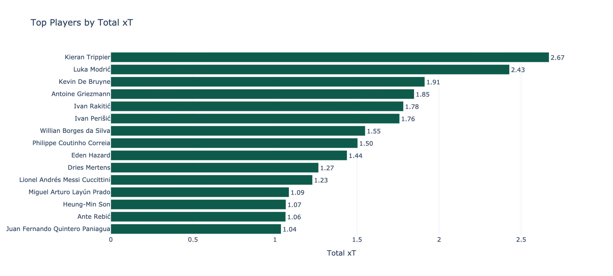
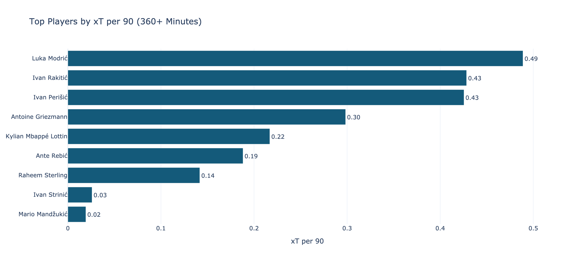
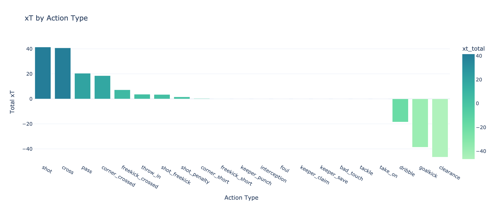
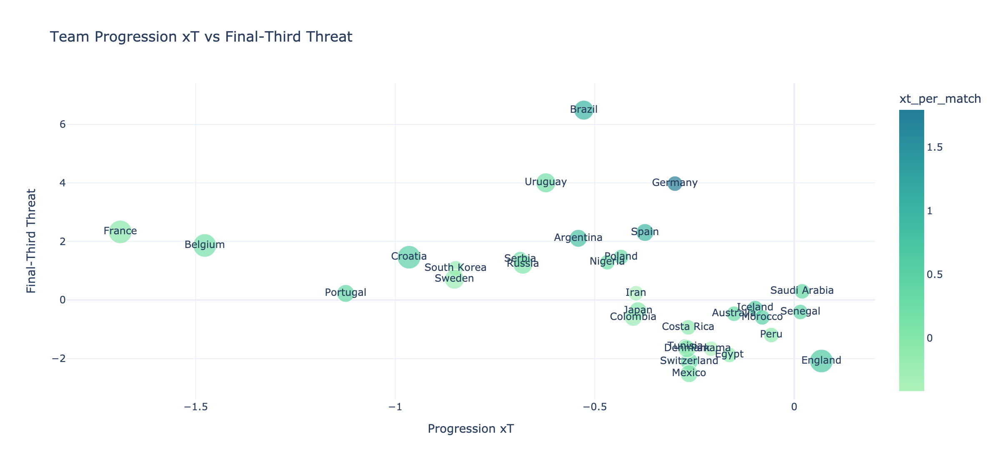
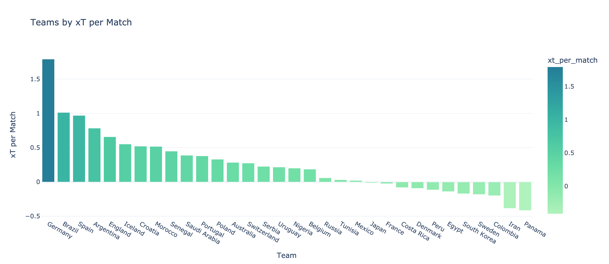
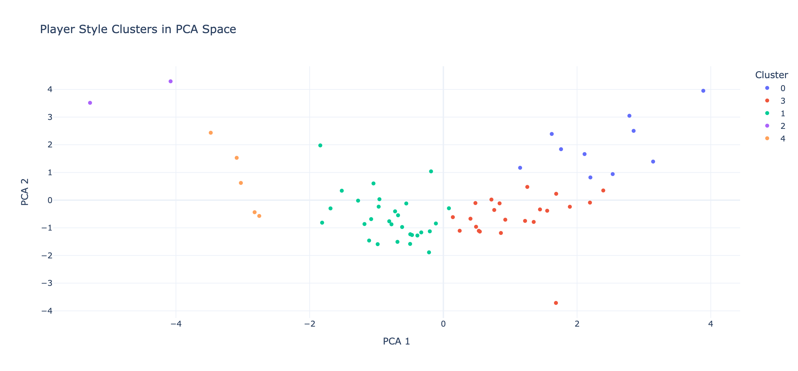

# Player Action Value & Possession Threat Explorer

This repository is organized around a single Jupyter notebook that presents the project as a football analytics case study built on possession value, action quality, and player style.

The notebook uses processed StatsBomb-based action data, xT-style action valuation, pandas, Plotly, and scikit-learn to answer a practical set of questions: which players add the most possession value, which actions drive that value, how teams differ in their threat creation patterns, and what clustering reveals about player style beyond standard leaderboards.

## Main Notebook

- [Open the notebook](notebooks/player_action_value_explorer.ipynb)
- nbviewer template: `https://nbviewer.org/github/<your-github-username>/<your-repo-name>/blob/main/notebooks/player_action_value_explorer.ipynb`

## Why This Project Matters

Goals and assists are useful outcomes, but they miss much of the work that improves a possession before the final action. A progression pass, carry, or dribble can materially improve the quality of an attack without appearing in headline output.

This project uses action-level possession framing and expected threat to make that value visible. The result is a notebook designed to feel closer to club-style reporting than to a fan dashboard or a purely academic model walk-through.

## What Data Is Used

The notebook is built on four processed parquet outputs in `data/processed/`:

- `actions.parquet`: action-level possession data with xT-related fields
- `player_summary.parquet`: player-level possession-value summaries
- `team_summary.parquet`: team-level threat and style summaries
- `action_type_summary.parquet`: action-type contribution summaries

Those processed files are the source of truth for the notebook analysis layer.

## Notebook Structure

The notebook is organized into these sections:

1. Title and project overview
2. Data used in this project
3. Data source and methodology
4. Data loading
5. Player value exploration
6. Action type analysis
7. Team style analysis
8. Low-volume, high-value profiles
9. ML extension: player style clustering and similarity
10. Key findings
11. Next steps

## GitHub-Friendly Static Views

GitHub does not reliably preserve interactive Plotly outputs inside notebooks. To keep the project readable on GitHub, the notebook now exports the main figures as static PNG files into `assets/` when it runs locally.

Running the notebook refreshes these chart exports:













## What The ML Extension Adds

The notebook includes a player-style clustering and similarity section built from interpretable action-value features. The aim is not just to rank players by output, but to show different ways they generate value and identify stylistic matches that could support profiling, comparison, and scouting work.

## Repository Structure

```text
player-action-value-explorer/
├── notebooks/
│   └── player_action_value_explorer.ipynb
├── src/
│   ├── load_data.py
│   ├── build_actions.py
│   ├── compute_xt.py
│   ├── player_profiles.py
│   ├── team_profiles.py
│   ├── export_outputs.py
│   └── charts.py
├── data/
│   ├── raw/
│   ├── processed/
│   └── README.md
├── assets/
├── requirements.txt
├── README.md
└── .gitignore
```

## Setup

Create and activate a Python environment, then install dependencies:

```bash
python -m venv .venv
source .venv/bin/activate
pip install --upgrade pip
pip install -r requirements.txt
```

If you want a dedicated notebook kernel:

```bash
python -m ipykernel install --user --name player-action-value-explorer --display-name "Player Action Value Explorer"
```

## How To Run The Notebook

From the repository root:

```bash
jupyter lab
```

or

```bash
jupyter notebook
```

Then open:

- `notebooks/player_action_value_explorer.ipynb`

## Optional: Regenerate Processed Outputs

If the processed parquet files are missing or need to be refreshed, run:

```bash
python -u scripts/run_pipeline.py
```

That rebuilds the action-level xT outputs and the summary tables used by the notebook.

## Legacy Quarto Site

The older `site/` Quarto structure remains in the repository, but it is no longer the main product. The notebook is now the clearest way to review the project.
